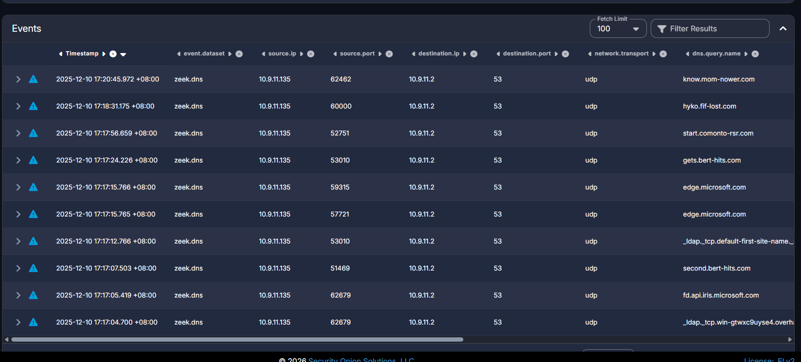

P1-02 - DNS Resolver

Scenario: Operation Shadow Relay, Phase 1

My goal was to identify the internal IPv4 address being used as the affected workstation's DNS resolver.

I used Security Onion Hunt with the investigation window from December 10–20, 2025 (UTC).

Security Onion access: https://seco.cyberex.quest/

The affected workstation identified in P1-01 was 10.9.11.135. I reviewed its LandUpdate808 DNS lookup alert and saw that it requested the domain aatthews.cfd. The request was sent to 10.9.11.2, indicating that this address was handling the workstation's DNS traffic.

To verify the result, I searched for DNS requests from 10.9.11.135 that used port 53 and grouped them by destination IP:

tags:dns AND source.ip:"10.9.11.135" AND destination.port:53 | groupby destination.ip

The results confirmed 10.9.11.2 as the destination for the workstation's DNS requests. I also expanded a matching event to check the DNS response.

The relevant evidence was:

*Alert rule: ET EXPLOIT_KIT LandUpdate808 Domain in DNS Lookup
*Queried domain: aatthews.cfd
*Affected workstation: 10.9.11.135
*DNS query destination: 10.9.11.2

The Hunt Events screenshot shows repeated zeek.dns queries from 10.9.11.135 to 10.9.11.2 over UDP port 53. The top event shows a query for know.mom-nower.com at 2025-12-10 09:20:45.972 UTC. This time was converted from the +08:00 timestamp displayed in Hunt.

Based on the alert, the verification query, and the repeated DNS events, I identified 10.9.11.2 as the internal DNS resolver used by the affected workstation.

Answer: CTK{10.9.11.2}
