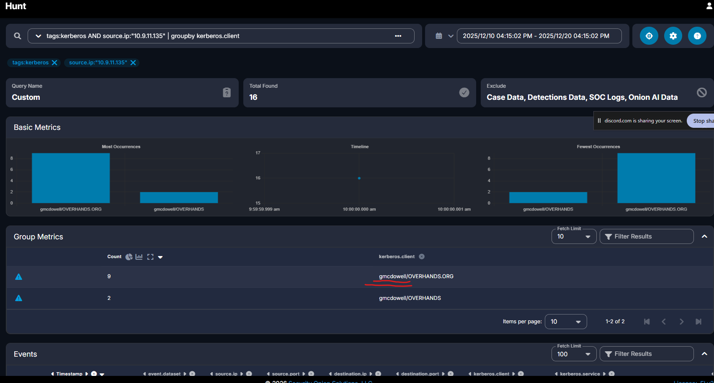

P1-04 - Workstation User Account

Scenario: Operation Shadow Relay, Phase 1

Objective:

Identify the Windows user account associated with the affected workstation.

Tool:

CTF Security Onion: https://seco.cyberex.quest/

Time range:

December 10–20, 2025 (UTC). If the Phase 1 import ID is available, I will apply it as an additional filter.

Investigation:

I used the affected workstation address from P1-01, 10.9.11.135, and searched its Kerberos events for client principals. The first dataset query returned no results because the indexed event name includes the Zeek prefix.

In Group Metrics, I reviewed the Kerberos client values and opened a matching event to confirm that the user principal and workstation IP appeared together. Windows machine accounts commonly end with a dollar sign, so I distinguished the user account from a machine account.

I recorded the exact principal and event timestamp in UTC. Because the principal included a realm suffix, I used only the username portion for the flag.

Primary query:

tags:kerberos AND source.ip:"10.9.11.135" | groupby kerberos.client

Fallback query:

If the tag query returns no results,

event.dataset:"zeek.kerberos" AND source.ip:"10.9.11.135" | groupby kerberos.client

Screenshot evidence:

The screenshot shows the query, Phase 1 time range, and Total Found value of 16. Group Metrics contains:

gmcdowell/OVERHANDS.ORG — 9 events

gmcdowell/OVERHANDS — 2 events

Both values identify the username as gmcdowell. The realm suffix is excluded from the flag.

Evidence:

Affected workstation: 10.9.11.135

Required evidence: A Kerberos event showing both the workstation IP and the user principal.

The Group Metrics and expanded-event screenshots should be saved beside this Markdown file.

Timestamp: Record the UTC timestamp from the matching event.

Finding:

The user account associated with the affected workstation is gmcdowell.

Answer:

CTK{gmcdowell}

Status:

Supported by the attached Security Onion Hunt screenshot.
