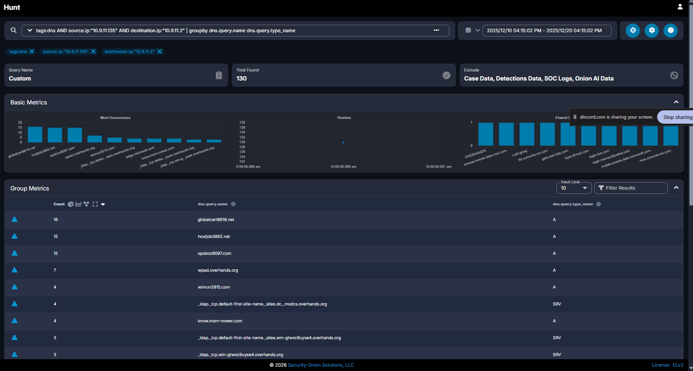

P1-05 - Active Directory DNS Domain

Scenario: Operation Shadow Relay, Phase 1

Objective:

Identify the Active Directory DNS domain associated with the affected workstation.

Tool:

CTF Security Onion: https://seco.cyberex.quest/

Time range:

December 10–20, 2025 (UTC). If the Phase 1 import ID is available, I will apply it as an additional filter.

Method:

I reviewed DNS queries from the affected workstation, 10.9.11.135, to the DNS resolver identified in P1-02, 10.9.11.2.

I looked for Active Directory service-discovery lookups, especially SRV records beginning with _ldap._tcp.dc._msdcs. or _kerberos._tcp. I expanded a matching event and recorded the query name, query type, resolver IP, and UTC timestamp.

I used the domain suffix from the service name as the answer.

Query:

tags:dns AND source.ip:"10.9.11.135" AND destination.ip:"10.9.11.2" | groupby dns.query.name dns.query.type_name

Screenshot evidence:

The screenshot shows Total Found of 130 DNS events and SRV queries containing the domain suffix overhands.org. Examples include:

_ldap._tcp.default-first-site-name._sites.dc._msdcs.overhands.org — SRV

_ldap._tcp.default-first-site-name._sites.win-gtwxc9uyse4.overhands.org — SRV

_ldap._tcp.win-gtwxc9uyse4.overhands.org — SRV

These Active Directory service-discovery names establish overhands.org as the DNS domain. The screenshot also shows the workstation source filter and resolver destination filter.

Evidence:

Affected workstation: 10.9.11.135

DNS resolver: 10.9.11.2

Required evidence: A DNS service-discovery event showing the Active Directory domain.

Finding:

The Active Directory DNS domain associated with the workstation is overhands.org.

Answer:

CTK{overhands.org}

Status:

Supported by the attached Security Onion Hunt screenshot.
