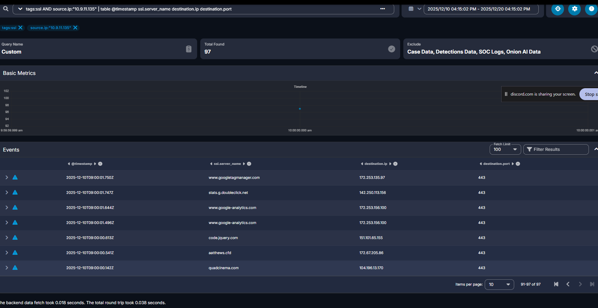

P1-06 - First Suspicious TLS Server Name

Scenario: Operation Shadow Relay, Phase 1

Objective:

Identify the first suspicious TLS server name and destination IPv4 address observed at the beginning of the phase. The answer requires the domain and IP separated by a pipe.

Tool:

CTF Security Onion: https://seco.cyberex.quest/

Time range:

December 10–20, 2025 (UTC). If the Phase 1 import ID is available, I will apply it as an additional filter.

Method:

I set the Phase 1 UTC time range and searched for SSL events from the affected workstation identified in P1-01, 10.9.11.135.

I first reviewed Group Metrics to confirm that SSL events existed and identify the available TLS server names. I then listed the events chronologically, sorted the timestamp from oldest to newest, and expanded the earliest relevant TLS event.

I recorded the TLS server name, destination IP, destination port, and UTC timestamp. If the SSL search returned no data, I would search without the source filter to check whether the CTF capture used a different source field.

Primary query:

tags:ssl AND source.ip:"10.9.11.135" | groupby ssl.server_name destination.ip

Fallback query:

event.dataset:"zeek.ssl" AND source.ip:"10.9.11.135" | groupby ssl.server_name destination.ip

Chronological events query:

tags:ssl AND source.ip:"10.9.11.135" | table @timestamp ssl.server_name destination.ip destination.port

Screenshot evidence:

The final Events page shows the earliest TLS records for the workstation. The first row in chronological order contains:

Timestamp: 2025-12-10T09:00:00.142Z

TLS server name: quadcinema.com

Destination IP: 104.196.13.170

Destination port: 443

The next event was aatthews.cfd at 2025-12-10T09:00:00.541Z. The challenge submission confirmed that the first row, quadcinema.com, was the intended suspicious TLS server name.

Evidence:

Affected workstation: 10.9.11.135

Required evidence: The earliest relevant TLS event showing the server name, destination IPv4 address, destination port, and UTC timestamp.

Finding:

The first suspicious TLS server name was quadcinema.com, contacted at 104.196.13.170.

Answer:

CTK{quadcinema.com|104.196.13.170}

Status:

Confirmed correct by the challenge platform on November 23, 2026.
