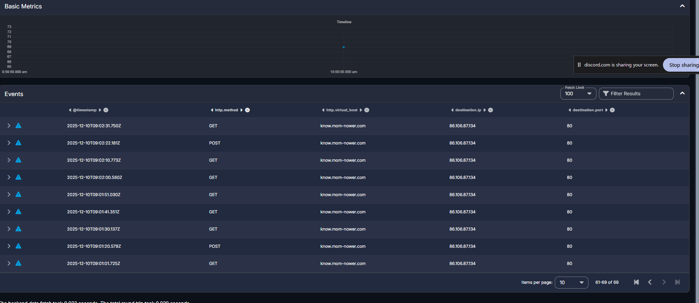

# P1-08 — First C2 Request Time

**Scenario** — Operation False Assurance, Phase 1

## Objective

Identify the UTC time of the first HTTP C2 request to the infrastructure identified in P1-07.

## Investigation

**Tool** — [CTF Security Onion](https://seco.cyberex.quest/), Hunt interface.

**Time range** — December 10–20, 2025, with the event timestamp displayed in UTC.

**Query**

```text
tags:http AND source.ip:"10.9.11.135" AND http.virtual_host:"know.mom-nower.com" | table @timestamp http.method http.virtual_host destination.ip destination.port | sortby @timestamp^
```

**Method**

1. Started with the affected workstation address from P1-01, `10.9.11.135`.
2. Filtered HTTP events to the principal C2 host identified in P1-07, `know.mom-nower.com`.
3. Confirmed the destination infrastructure was `86.106.87.134:80`.
4. Set the Events **Fetch Limit** to `100`. The query returned `69` matching events.
5. Used the Events pagination controls to open the final page, which displayed rows `61–69 of 69`.
6. Because the table was ordered newest first, the bottom row on the final page was the oldest request. It showed a `GET` at `2025-12-10T09:01:01.725Z`.
7. Removed milliseconds because the challenge flag format requires seconds, producing `2025-12-10 09:01:01 UTC`.

## Screenshot Evidence



The screenshot shows the final page of the filtered Events table. The bottom row contains:

- `@timestamp` — `2025-12-10T09:01:01.725Z`
- `http.method` — `GET`
- `http.virtual_host` — `know.mom-nower.com`
- `destination.ip` — `86.106.87.134`
- `destination.port` — `80`
- Pagination — `61–69 of 69`

## Evidence

| Field | Value |
| --- | --- |
| Affected workstation | `10.9.11.135` |
| C2 domain | `know.mom-nower.com` |
| C2 destination IPv4 | `86.106.87.134` |
| C2 destination port | `80` |
| First request method | `GET` |
| First request timestamp | `2025-12-10T09:01:01.725Z` |
| Flag timestamp precision | Seconds, milliseconds omitted |

## Finding

The first HTTP C2 request was observed at `2025-12-10 09:01:01 UTC`.

## Answer

```text
CTK{2025-12-10 09:01:01 UTC}
```

**Status** — Supported by the attached Security Onion Hunt screenshot.
