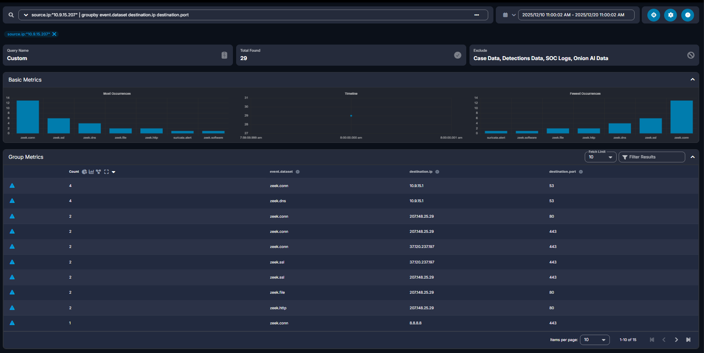
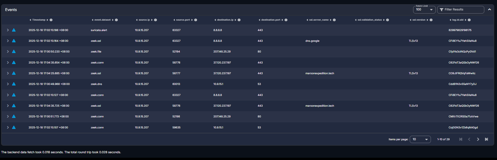
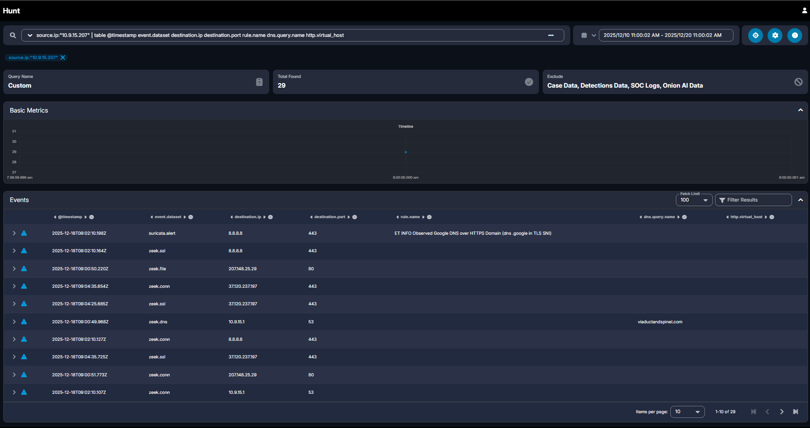

P5-01 - Affected Workstation

Scenario: Operation Shadow Relay, Phase 5

Objective:

Identify the internal IPv4 address associated with the suspicious multi-stage activity.

Answer format:

CTK{IPv4}

Tool:

CTF Security Onion Hunt: https://seco.cyberex.quest/

Time range:

December 10–20, 2025, with timestamps reviewed in UTC.

Investigation scope:

I first searched the full scenario window for alert activity. After identifying a possible workstation, I verified it by searching all event types associated with its source IP.

Discovery query:

tags:alert | groupby source.ip

This query grouped the internal and external source addresses that generated alerts. The initial results included several sources from different phases and external infrastructure.

Candidate verification query:

tags:alert AND source.ip:"10.9.15.207" | groupby rule.name source.ip destination.ip

The alert-only search returned one low-severity Google DNS-over-HTTPS alert. Since this result was not enough to confirm the workstation, I broadened the search to all event types for the same source.

Full-activity verification query:

source.ip:"10.9.15.207" | table @timestamp event.dataset destination.ip destination.port rule.name dns.query.name http.virtual_host

Method:

1. I ran the alert discovery query and reviewed the source-IP groups.
2. I tested 10.9.15.207 with the alert-only query.
3. I confirmed that the alert-only view contained only one low-severity event.
4. I removed the tags:alert restriction and searched all records from 10.9.15.207.
5. I reviewed 29 events across zeek.conn, zeek.ssl, zeek.dns, zeek.file, zeek.http, suricata.alert, and zeek.software.
6. I correlated the internal DNS traffic, external TLS activity, DNS query, HTTP and file activity, and destination ports to confirm a multi-stage sequence.
7. I submitted the candidate flag, and the challenge platform accepted CTK{10.9.15.207}.

Screenshot evidence:

The discovery screenshot shows the source-IP groups and broad alert results. It establishes the candidate addresses but does not independently prove the final workstation.

The candidate alert screenshot shows three related download alerts where 10.10.1.128 is the destination of traffic from 107.175.82.242. This activity occurred on December 16 and represented a different candidate, so it was rejected.

The full-activity screenshot shows 29 events from 10.9.15.207, including DNS traffic to the internal resolver at 10.9.15.1, TLS traffic with the server name maroonexpedition.tech, a DNS query for viaductandspinel.com, file and HTTP activity to 207.148.25.29, and connections to external infrastructure on ports 80 and 443.

Evidence:

Affected workstation IPv4: 10.9.15.207

Total full-activity events: 29

Internal DNS resolver: 10.9.15.1

Suspicious TLS server name: maroonexpedition.tech

Suspicious DNS query: viaductandspinel.com

File and HTTP destination: 207.148.25.29

Finding:

The internal workstation associated with the Phase 5 multi-stage activity was 10.9.15.207.

Answer:

CTK{10.9.15.207}

Status:

Confirmed correct by the challenge platform.
