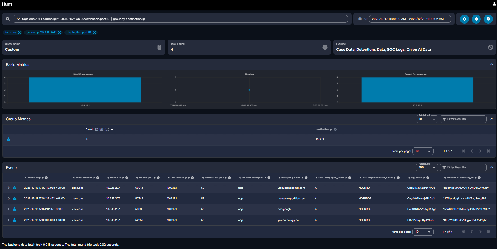
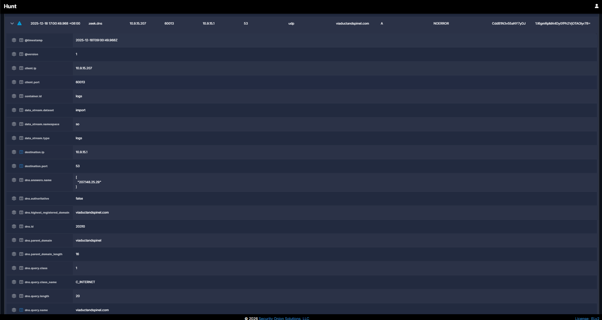

P5-02 - DNS Resolver

Scenario: Operation Shadow Relay, Phase 5

Objective:

Identify the internal IPv4 address that served as the affected workstation's DNS resolver.

Answer format:

CTK{IPv4}

Tool:

CTF Security Onion Hunt: https://seco.cyberex.quest/

Workstation:

10.9.15.207, established in P5-01.

Time range:

December 10–20, 2025, with timestamps reviewed in UTC.

Method:

I set the Phase 5 investigation time range in Hunt and filtered DNS traffic to the affected workstation, 10.9.15.207.

I restricted the results to destination port 53, grouped the events by destination IP, and reviewed the Group Metrics results. The results contained one resolver, 10.9.15.1, with four matching events.

I expanded the first DNS event to verify the source IP, resolver IP, port, query name, response code, transport, and UTC timestamp.

Query:

tags:dns AND source.ip:"10.9.15.207" AND destination.port:53 | groupby destination.ip

Screenshot evidence:

The Group Metrics screenshot shows Total Found of 4, destination IP 10.9.15.1, and a group count of 4.

The expanded event shows:

Timestamp: 2025-12-18T09:00:49.968Z

Client IP: 10.9.15.207

Destination IP: 10.9.15.1

Destination port: 53

DNS query name: viaductandspinel.com

DNS response: NOERROR

Transport: UDP

Evidence:

Affected workstation: 10.9.15.207

DNS resolver IPv4: 10.9.15.1

DNS port: 53

Transport: UDP

Example query: viaductandspinel.com

Example response: NOERROR

Example timestamp: 2025-12-18T09:00:49.968Z

Finding:

The internal DNS resolver used by the affected workstation was 10.9.15.1.

Answer:

CTK{10.9.15.1}

Status:

Supported by the attached Security Onion Hunt screenshots.
