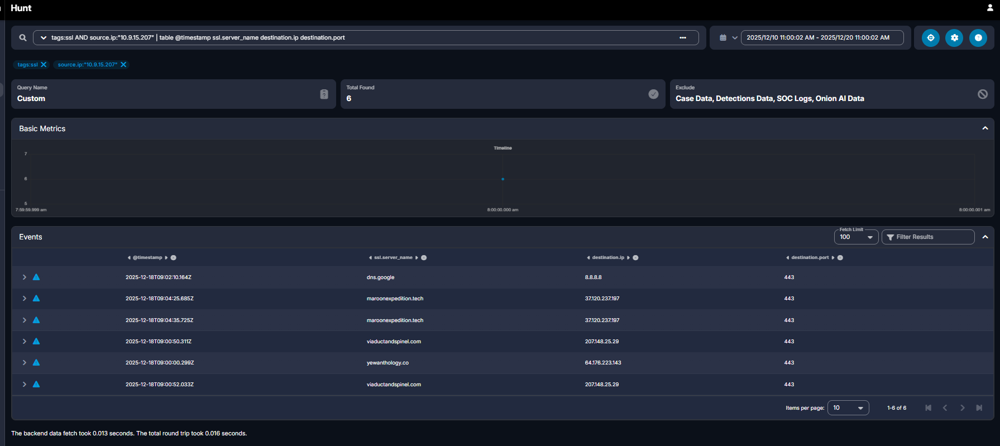

P5-03 - Initial TLS Infrastructure

Scenario: Operation Shadow Relay, Phase 5

Objective:

Identify the first suspicious TLS server name and destination IPv4 address observed during the phase.

Answer format:

CTK{hostname|IPv4}

Tool:

CTF Security Onion Hunt: https://seco.cyberex.quest/

Workstation:

10.9.15.207, established in P5-01.

Time range:

December 10–20, 2025, with timestamps reviewed in UTC.

Method:

I filtered TLS events to the affected workstation, 10.9.15.207, and set the Events Fetch Limit high enough to include all matching records. The query returned six TLS events.

I compared the timestamps in UTC and identified the earliest suspicious server name. I excluded dns.google because it represented the workstation's ordinary Google DNS-over-HTTPS connection.

The earliest suspicious TLS event was yewanthology.co at 2025-12-18T09:00:00.299Z. It connected to 64.176.223.143 on port 443.

Personal note:

At first, I thought I had the answer just by looking at the TLS server names, but I almost treated the dns.google connection as suspicious too. I had to slow down, compare the timestamps, and separate the workstation's normal DNS-over-HTTPS traffic from the actual suspicious activity. Once I did that, the correct first suspicious connection became clear.

Discovery query:

tags:ssl AND source.ip:"10.9.15.207" | table @timestamp ssl.server_name destination.ip destination.port

This query lists the timestamp, TLS server name, destination IP, and destination port for each event.

Screenshot evidence:

The screenshot shows six TLS events from 10.9.15.207. The earliest suspicious row contains:

Timestamp: 2025-12-18T09:00:00.299Z

TLS server name: yewanthology.co

Destination IP: 64.176.223.143

Destination port: 443

The table also shows later TLS activity for viaductandspinel.com and maroonexpedition.tech. The dns.google row was excluded as ordinary DNS-over-HTTPS infrastructure.

Evidence:

Affected workstation: 10.9.15.207

First suspicious TLS server name: yewanthology.co

Destination IPv4: 64.176.223.143

Destination port: 443

First observed timestamp: 2025-12-18T09:00:00.299Z

TLS event count: 6

Finding:

The first suspicious TLS infrastructure was yewanthology.co at 64.176.223.143.

Answer:

CTK{yewanthology.co|64.176.223.143}

Status:

Confirmed correct by the challenge platform.
