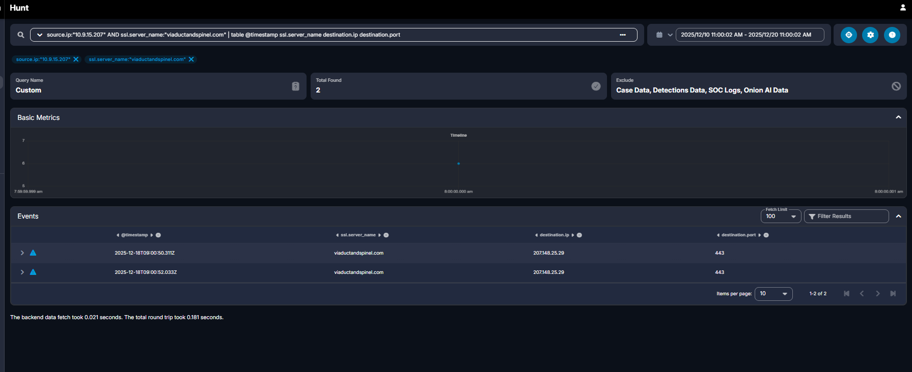
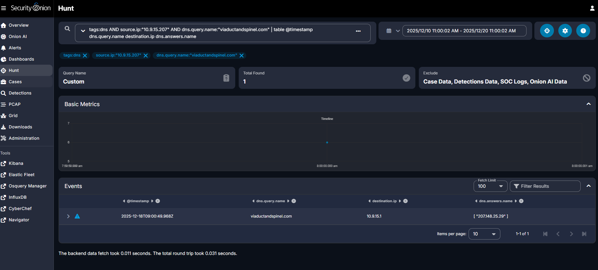

P5-04 - Staging Infrastructure

Scenario: Operation Shadow Relay, Phase 5

Objective:

Identify the next staging domain and IPv4 address after the initial TLS infrastructure.

Answer format:

CTK{domain|IPv4}

Tool:

CTF Security Onion Hunt: https://seco.cyberex.quest/

Workstation:

10.9.15.207, established in P5-01.

Initial TLS infrastructure:

yewanthology.co at 64.176.223.143, established in P5-03.

Time range:

December 10–20, 2025, with timestamps reviewed in UTC.

Method:

I started with the confirmed workstation address from P5-01 and reviewed its events in a single timeline. This allowed me to look for the next piece of infrastructure after the initial TLS connection and compare the TLS and DNS activity.

I found two TLS events for viaductandspinel.com at 2025-12-18T09:00:50.311Z and 2025-12-18T09:00:52.033Z. Both connected to 207.148.25.29 on port 443.

I then searched DNS events for the same domain and confirmed that the workstation requested it through the resolver at 10.9.15.1. The DNS response also returned 207.148.25.29, which matched the TLS destination.

Discovery query:

source.ip:"10.9.15.207" | table @timestamp event.dataset ssl.server_name dns.query.name destination.ip destination.port

This query displays the workstation's events in one timeline so the TLS and DNS records can be compared.

TLS verification query:

source.ip:"10.9.15.207" AND ssl.server_name:"viaductandspinel.com" | table @timestamp ssl.server_name destination.ip destination.port

DNS verification query:

tags:dns AND source.ip:"10.9.15.207" AND dns.query.name:"viaductandspinel.com" | table @timestamp dns.query.name destination.ip dns.answers.name

Personal note:

At first, I thought the initial TLS domain was the only important lead, so I almost stopped there. I was relieved when the timeline showed another domain, but I still had to verify that it was not just an unrelated DNS request. Comparing the DNS answer with the later TLS destination gave me the confidence that viaductandspinel.com was the actual staging infrastructure.

Screenshot evidence:

The TLS screenshot shows two events for viaductandspinel.com with destination 207.148.25.29 on port 443.

The DNS screenshot shows one event containing:

DNS query name: viaductandspinel.com

Resolver destination IP: 10.9.15.1

DNS answer: 207.148.25.29

Timestamp: 2025-12-18T09:00:49.968Z

The TLS and DNS views corroborate the staging domain and its IPv4 address.

Evidence:

Affected workstation: 10.9.15.207

Staging domain: viaductandspinel.com

Staging IPv4: 207.148.25.29

TLS destination port: 443

TLS event timestamps: 2025-12-18T09:00:50.311Z and 2025-12-18T09:00:52.033Z

DNS answer timestamp: 2025-12-18T09:00:49.968Z

Finding:

The subsequent staging infrastructure was viaductandspinel.com at 207.148.25.29.

Answer:

CTK{viaductandspinel.com|207.148.25.29}

Status:

Confirmed correct by the challenge platform.
