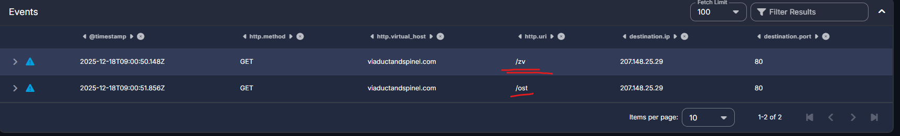

P5-05 - First Staging URI

Scenario: Operation Shadow Relay, Phase 5

Objective:

Identify the first HTTP URI requested from the staging infrastructure identified in P5-04.

Answer format:

CTK{/path}

Tool:

CTF Security Onion Hunt: https://seco.cyberex.quest/

Workstation:

10.9.15.207, established in P5-01.

Staging infrastructure:

viaductandspinel.com at 207.148.25.29, established in P5-04.

Time range:

December 10–20, 2025, with timestamps reviewed in UTC.

Method:

I started with the staging IP from P5-04, 207.148.25.29, and filtered HTTP events to the affected workstation, 10.9.15.207.

I set the Events Fetch Limit to 100 and reviewed both matching events. I compared their UTC timestamps rather than relying only on the URI text or the order in which the rows appeared.

The first request was GET /zv at 2025-12-18T09:00:50.148Z. The second request was GET /ost at 2025-12-18T09:00:51.856Z. Since /zv occurred first, I selected it as the answer.

Query:

tags:http AND source.ip:"10.9.15.207" AND destination.ip:"207.148.25.29" | table @timestamp http.method http.virtual_host http.uri destination.ip destination.port

This query displays the timestamp, HTTP method, virtual host, URI, destination IP, and destination port for requests from the workstation to the staging IP.

Personal note:

I initially thought the first URI might simply be the first row shown in Hunt, but I did not want to trust the display order without checking the timestamps. Seeing both requests so close together made me double-check the times, and that confirmed that /zv came before /ost.

Screenshot evidence:

The screenshot shows both requests to viaductandspinel.com at 207.148.25.29 on port 80:

First request: 2025-12-18T09:00:50.148Z, GET, /zv

Second request: 2025-12-18T09:00:51.856Z, GET, /ost

Evidence:

Affected workstation: 10.9.15.207

Staging hostname: viaductandspinel.com

Staging IPv4: 207.148.25.29

Destination port: 80

First HTTP method: GET

First HTTP URI: /zv

First request timestamp: 2025-12-18T09:00:50.148Z

Finding:

The first HTTP URI requested from the staging infrastructure was /zv.

Answer:

CTK{/zv}

Status:

Confirmed correct by the challenge platform.
