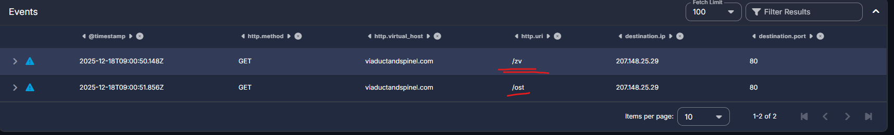

P5-06 - Second Staging URI

Scenario: Operation Shadow Relay, Phase 5

Objective:

Identify the second suspicious HTTP URI requested from the staging infrastructure identified in P5-04.

Answer format:

CTK{/path}

Tool:

CTF Security Onion Hunt: https://seco.cyberex.quest/

Workstation:

10.9.15.207, established in P5-01.

Staging infrastructure:

viaductandspinel.com at 207.148.25.29, established in P5-04.

Time range:

December 10–20, 2025, with timestamps reviewed in UTC.

Method:

I reused the staging destination identified in P5-04, 207.148.25.29, and limited the search to HTTP events generated by workstation 10.9.15.207.

I reviewed the two matching events and compared their UTC timestamps to establish the sequence instead of assuming that the table order was correct.

The first request was GET /zv at 2025-12-18T09:00:50.148Z. The next request was GET /ost at 2025-12-18T09:00:51.856Z. Because /ost occurred after /zv and used the same staging host and IP, I selected /ost as the second staging URI.

Query:

tags:http AND source.ip:"10.9.15.207" AND destination.ip:"207.148.25.29" | table @timestamp http.method http.virtual_host http.uri destination.ip destination.port

This query displays the request timestamp, method, host, URI, destination IP, and port so the requests can be ordered directly.

Personal note:

I had already found /zv in the previous step, so I was worried that I might accidentally submit the same URI again. I checked the timestamps carefully, and seeing /ost immediately after /zv made the sequence clear. It was a small detail, but getting the order right was the whole point of this question.

Screenshot evidence:

The screenshot shows both requests to viaductandspinel.com at 207.148.25.29 on port 80:

First request: 2025-12-18T09:00:50.148Z, GET, /zv

Second request: 2025-12-18T09:00:51.856Z, GET, /ost

Evidence:

Affected workstation: 10.9.15.207

Staging hostname: viaductandspinel.com

Staging IPv4: 207.148.25.29

Destination port: 80

First URI: /zv

Second URI: /ost

Second request timestamp: 2025-12-18T09:00:51.856Z

Finding:

The second suspicious HTTP URI requested from the same staging infrastructure was /ost.

Answer:

CTK{/ost}

Status:

Confirmed correct by the challenge platform.
