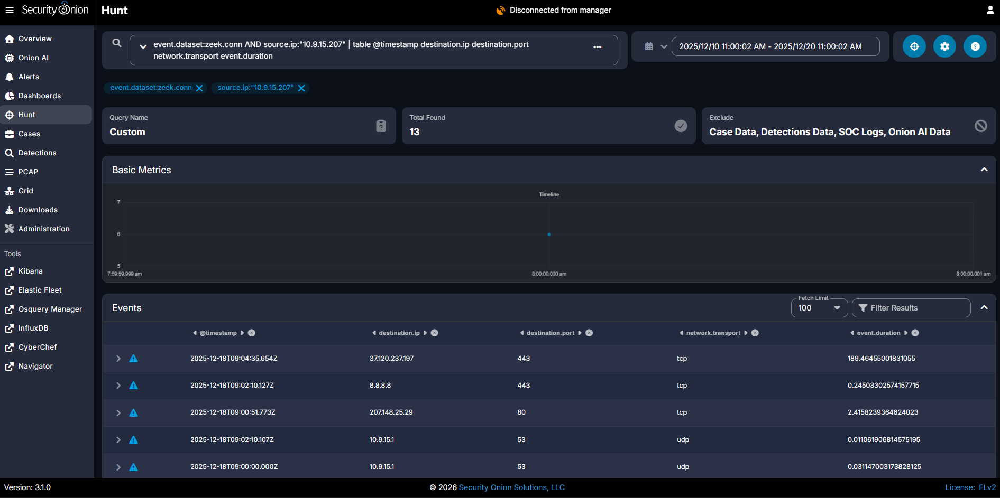
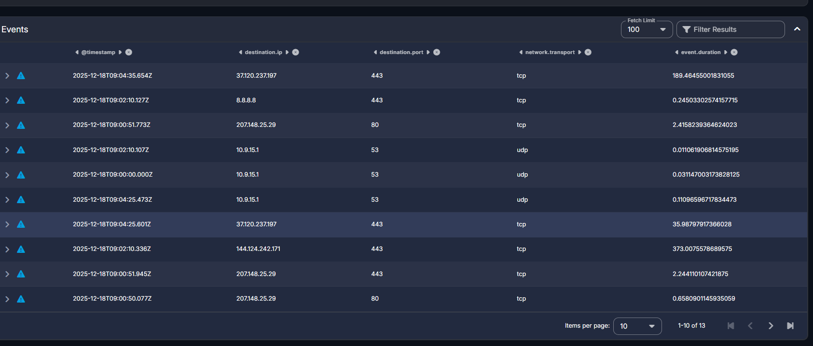

P5-07 - Long-Lived C2

Scenario: Operation Shadow Relay, Phase 5

Objective:

Identify the long-lived external bare-IP command-and-control destination and port.

Answer format:

CTK{IPv4|port}

Tool:

CTF Security Onion Hunt: https://seco.cyberex.quest/

Affected workstation:

10.9.15.207, established in P5-01.

Time range:

December 10–20, 2025, with timestamps reviewed in UTC.

Relevant dataset:

zeek.conn

Method:

I searched the Zeek connection records for all connections from the confirmed Phase 5 workstation. I included the connection duration in the results so I could compare the external connections directly rather than relying on alert counts or DNS frequency.

The search returned 13 events. I checked the complete result set, including the rows beyond the initial first 10 results.

I excluded the internal DNS resolver at 10.9.15.1:53 and the ordinary Google DNS connection at 8.8.8.8:443 from the C2 assessment.

The connection to 37.120.237.197:443 lasted about 35.99 seconds, but the connection to 144.124.242.171:443 lasted 373.0075578689575 seconds. This made 144.124.242.171:443 the clear long-lived external bare-IP connection.

Discovery query:

event.dataset:zeek.conn AND source.ip:"10.9.15.207" | table @timestamp destination.ip destination.port network.transport event.duration

This query lists the destination IP, destination port, transport protocol, and connection duration for each connection.

Personal note:

At first, I thought the 35-second connection might be the C2 channel because it was noticeably longer than the staging traffic. After checking every result, I realized there was an even longer connection that I had almost overlooked. That was a good reminder not to stop at the first suspicious-looking event and to compare the complete result set.

Screenshot evidence:

The overview shows the Hunt query, Phase 5 time range, and Zeek connection results. It also shows the shorter 37.120.237.197:443 connection and the longer connection from the same workstation.

The detailed Events table records:

144.124.242.171:443 over TCP, starting at 2025-12-18T09:02:10.336Z, with a duration of 373.0075578689575 seconds.

37.120.237.197:443 over TCP, starting at 2025-12-18T09:04:25.601Z, with a duration of 35.98797917366028 seconds.

207.148.25.29:80 over TCP, with a duration of 2.4158239364624023 seconds.

207.148.25.29:443 over TCP, with a duration of 2.244110107421875 seconds.

The 144.124.242.171:443 record is the longest external connection in the result set by a wide margin.

Evidence:

Workstation source IP: 10.9.15.207

Event dataset: zeek.conn

C2 destination IPv4: 144.124.242.171

C2 destination port: 443

Transport: TCP

Connection start timestamp: 2025-12-18T09:02:10.336Z

Connection duration: 373.0075578689575 seconds

Finding:

The long-lived external bare-IP C2 connection was 144.124.242.171 over TCP port 443.

Answer:

CTK{144.124.242.171|443}

Status:

Confirmed correct by the challenge platform.
