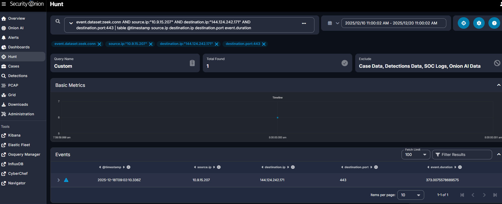
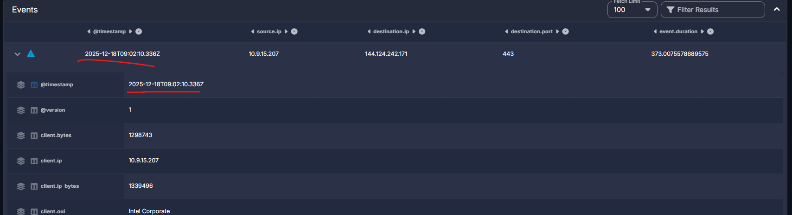

P5-08 - C2 Start Time

Scenario: Operation Shadow Relay, Phase 5

Objective:

Determine the UTC time when the long-lived C2 connection identified in P5-07 began.

Answer format:

CTK{YYYY-MM-DD HH:MM:SS UTC}

Tool:

CTF Security Onion Hunt: https://seco.cyberex.quest/

Affected workstation:

10.9.15.207.

C2 endpoint:

144.124.242.171:443, identified in P5-07.

Time range:

December 10–20, 2025, with the timestamp interpreted as UTC.

Method:

I reused the confirmed C2 destination from P5-07 and filtered the Zeek connection records to the affected workstation, 10.9.15.207.

I displayed the timestamp, source IP, destination IP, destination port, and connection duration. The query returned exactly one event.

The event timestamp was 2025-12-18T09:02:10.336Z. The trailing Z indicates UTC, so I removed the milliseconds to match the required challenge format and submitted 2025-12-18 09:02:10 UTC.

Query:

event.dataset:zeek.conn AND source.ip:"10.9.15.207" AND destination.ip:"144.124.242.171" AND destination.port:443 | table @timestamp source.ip destination.ip destination.port event.duration

This query isolates the single Zeek connection used for the C2 finding.

Personal note:

I initially worried that I might use the time when the C2 traffic was first noticed instead of the actual connection start time. I checked the exact event timestamp and kept the UTC indicator in mind before converting it to the format required by the challenge. Removing only the milliseconds helped me avoid changing the actual start time.

Screenshot evidence:

The screenshot shows one matching event with the following details:

Timestamp: 2025-12-18T09:02:10.336Z

Source IP: 10.9.15.207

Destination IP: 144.124.242.171

Destination port: 443

Connection duration: 373.0075578689575 seconds

The expanded event confirms the same timestamp and shows the client IP as 10.9.15.207. It also records client.bytes as 1298743, client.ip_bytes as 1339496, and the client OUI as Intel Corporate. These fields further support that the event belongs to the affected workstation.

Evidence:

Connection start timestamp in Security Onion: 2025-12-18T09:02:10.336Z

UTC timestamp used for submission: 2025-12-18 09:02:10 UTC

Workstation: 10.9.15.207

C2 endpoint: 144.124.242.171:443

Finding:

The long-lived C2 connection began at 2025-12-18 09:02:10 UTC.

Answer:

CTK{2025-12-18 09:02:10 UTC}

Status:

Confirmed correct by the challenge platform.
