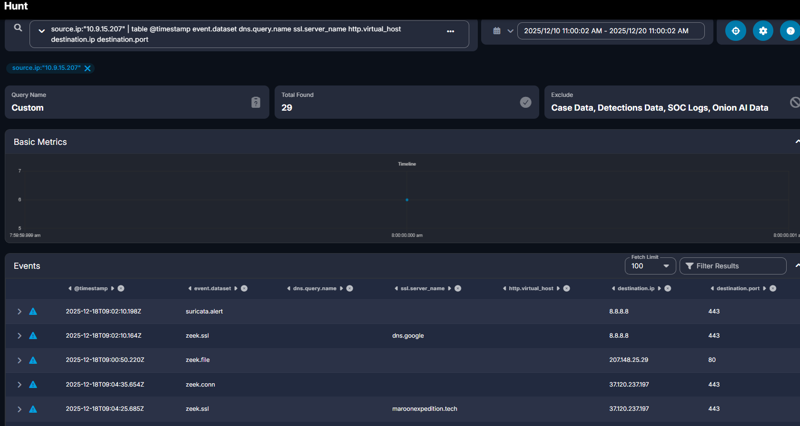
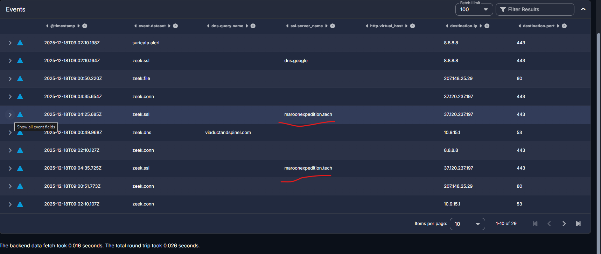
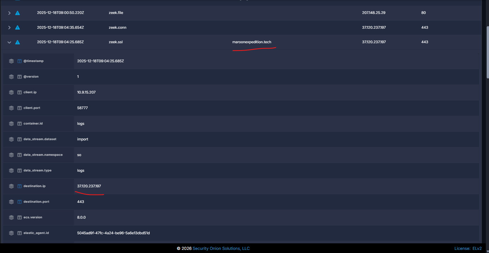

P5-09 - Remote Management Infrastructure

Scenario: Operation Shadow Relay, Phase 5

Objective:

Identify the later remote-management-related domain and destination IPv4 address.

Answer format:

CTK{domain|IPv4}

Tool:

CTF Security Onion Hunt: https://seco.cyberex.quest/

Affected workstation:

10.9.15.207, established in P5-01.

Time range:

December 10–20, 2025, with timestamps reviewed in UTC.

Relevant records:

Zeek TLS, Zeek connection, and related event records.

Method:

I started with the confirmed Phase 5 workstation, 10.9.15.207, and reviewed its DNS, TLS, HTTP, and connection records in one timeline.

I used the timeline to separate the initial TLS infrastructure and staging activity from the later external activity. I then located the later Zeek TLS records for maroonexpedition.tech.

Both TLS records mapped the hostname to 37.120.237.197 on port 443. I expanded one matching event to verify the client IP, destination IP, destination port, and exact timestamp.

Because the hostname and IP appeared together in repeated later TLS events, I identified them as the remote-management-related infrastructure requested by the challenge.

Discovery query:

source.ip:"10.9.15.207" | table @timestamp event.dataset dns.query.name ssl.server_name http.virtual_host destination.ip destination.port

This query provides a timeline across the workstation's DNS, TLS, HTTP, and connection records.

Verification query:

tags:ssl AND source.ip:"10.9.15.207" AND ssl.server_name:"maroonexpedition.tech" | table @timestamp ssl.server_name destination.ip destination.port

Personal note:

At first, I was unsure whether this traffic was simply another normal TLS connection because remote-management tools can look legitimate at a glance. I went back through the timeline and checked the repeated hostname-to-IP pairing instead of judging the traffic from the domain name alone. That extra comparison helped me feel confident that this was the later infrastructure the question was asking for.

Screenshot evidence:

The timeline shows a later zeek.ssl event for maroonexpedition.tech at 37.120.237.197:443, after the staging connection to 207.148.25.29.

The event table shows the repeated correlation:

2025-12-18T09:04:25.685Z, zeek.ssl, maroonexpedition.tech, 37.120.237.197, port 443

2025-12-18T09:04:35.725Z, zeek.ssl, maroonexpedition.tech, 37.120.237.197, port 443

The expanded event confirms:

Client IP: 10.9.15.207

Destination IP: 37.120.237.197

Destination port: 443

TLS server name: maroonexpedition.tech

Event timestamp: 2025-12-18T09:04:25.685Z

Evidence:

Workstation source IP: 10.9.15.207

Remote-management-related domain: maroonexpedition.tech

Destination IPv4: 37.120.237.197

Destination port: 443

First shown matching TLS timestamp: 2025-12-18T09:04:25.685Z

Later matching TLS timestamp: 2025-12-18T09:04:35.725Z

Finding:

The later remote-management-related infrastructure was maroonexpedition.tech at 37.120.237.197.

Answer:

CTK{maroonexpedition.tech|37.120.237.197}

Status:

Confirmed correct by the challenge platform.
