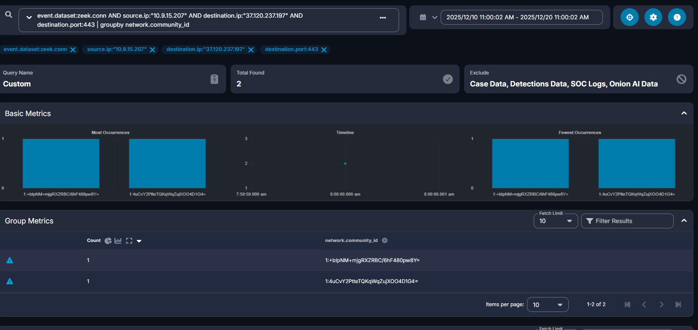
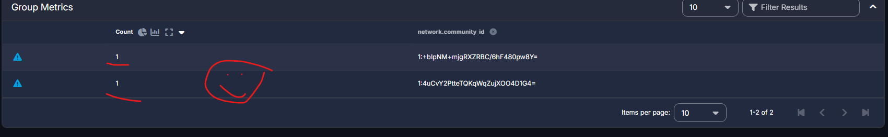

P5-10 - Remote Management Connections

Scenario: Operation Shadow Relay, Phase 5

Objective:

Count the distinct TCP/443 connections made from the affected workstation to the remote-management endpoint identified in P5-09.

Answer format:

CTK{number}

Tool:

CTF Security Onion Hunt: https://seco.cyberex.quest/

Affected workstation:

10.9.15.207.

Remote-management destination:

37.120.237.197, identified in P5-09.

Destination port:

443.

Time range:

December 10–20, 2025, with timestamps reviewed in UTC.

Dataset:

zeek.conn

Method:

I reused the affected workstation from P5-01 and the remote-management destination from P5-09. I restricted the search to Zeek connection records for destination 37.120.237.197 on TCP port 443.

I grouped the matching records by network.community_id, which identifies individual connections. Security Onion returned two rows, each with a count of 1 and a different community ID.

Because there were two distinct identifiers, the workstation made two separate TCP/443 connections to the endpoint.

Query:

event.dataset:zeek.conn AND source.ip:"10.9.15.207" AND destination.ip:"37.120.237.197" AND destination.port:443 | groupby network.community_id

Personal note:

At first, I wondered whether the two rows represented duplicate records for the same connection. Grouping by network.community_id cleared that up because each row had a different identifier. Once I saw that both identifiers had their own count, I felt confident that the answer was two distinct connections.

Screenshot evidence:

The overview shows the exact filters, Total Found of 2, and two separate network.community_id groups.

The Group Metrics table shows:

Count 1: 1:+blpNM+mjgRXZRBC/6hF480pw8Y=

Count 1: 1:4uCvY2PtteTQKqWqZujXO04D1G4=

Since there are two distinct identifiers, the connection count is 2.

Evidence:

Source workstation: 10.9.15.207

Destination IPv4: 37.120.237.197

Destination port: 443

Transport: TCP

Distinct community IDs: 2

Count per community ID: 1 each

Finding:

Two distinct TCP/443 connections were made from 10.9.15.207 to 37.120.237.197.

Answer:

CTK{2}

Status:

Confirmed correct by the challenge platform.
